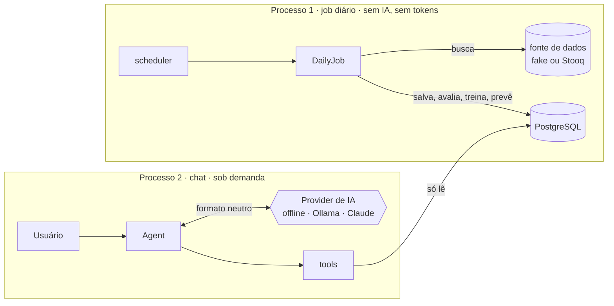

# MarketPulse AI


**Um assistente que usa IA para explicar o mercado, e não para adivinhá-lo, e que mostra o próprio histórico de acertos.**

O MarketPulse é um chat que traduz cotações e previsões estatísticas para investidores iniciantes. Um modelo estatístico próprio aprende com o histórico de preços num job diário, sem IA. No chat, um LLM (Claude, um modelo local no Ollama ou um modo offline) decide quais dados buscar e explica o resultado em linguagem simples.

> ⚠️ Projeto educacional. Nada aqui é recomendação de investimento.

## Arquitetura

Dois processos e quatro módulos, com dependências em uma só direção ([ADR-004](docs/adr/004-modulos-e-dois-processos.md)):



```
chat ──► llm
  ├────► forecasting ──► market_data
  └────► market_data
```

**Princípio central:** o código calcula, a IA interpreta. O LLM nunca produz números: ele chama tools que leem dados e previsões calculados de forma determinística, com fonte e horário.

## Começando

### Com Docker (recomendado)

```bash
cp .env.example .env                       # padrão: IA offline + dados simulados, custo zero
docker compose build
docker compose run --rm chat ruby bin/forecast_job   # treina e salva as previsões
docker compose run --rm chat                         # abre o chat
```

Perguntas para testar: *"Como está a AAPL?"*, *"Qual a previsão da PETR4?"*, *"E a XPTO?"*.

Para deixar o job diário rodando sozinho:

```bash
docker compose up -d scheduler
docker compose logs -f scheduler
```

### Sem Docker (Ruby 3.2+, sem gems, dados em memória)

```bash
ruby bin/chat
```

## Escolhendo a IA

A escolha é feita no `.env`, uma vez ([ADR-003](docs/adr/003-camada-de-llm-agnostica.md)):

| `LLM_PROVIDER` | Para onde vai a requisição | Custo |
|---|---|---|
| `offline` | lugar nenhum: regras locais | zero |
| `ollama` | modelo aberto rodando no seu Docker | zero |
| `anthropic` | API do Claude (`ANTHROPIC_API_KEY`) | por token |
| `openai_compatible` | qualquer API no formato OpenAI (`LLM_BASE_URL`) | depende |

### Usando o Ollama (IA local e gratuita)

```bash
docker compose --profile ollama up -d ollama
docker compose exec ollama ollama pull qwen2.5:3b     # ~2 GB, baixa uma vez
```

No `.env`:

```
LLM_PROVIDER=ollama
LLM_MODEL=qwen2.5:3b
LLM_FALLBACK=offline
```

Escolha modelos marcados com suporte a **tools** no catálogo do Ollama. Modelos de ~3B rodam na CPU com uns 4 GB de RAM livres, mas são lentos e erram mais na escolha de tools que modelos maiores.

## Escolhendo os dados

| `MARKET_DATA_SOURCE` | O que é |
|---|---|
| `fake` | Séries simuladas e determinísticas para AAPL, MSFT e PETR4, cada uma com um padrão escondido para o modelo descobrir |
| `stooq` | Histórico diário real e gratuito de ações dos EUA, sem chave. Defina `TICKERS=AAPL,MSFT,NVDA` |

## A previsão

- **Modelo:** `retorno_amanhã = peso × retorno_hoje`, treinado por mínimos quadrados. Peso positivo indica momentum; negativo, reversão à média; perto de zero (|t| < 2), nenhum padrão.
- **Baseline:** "amanhã = hoje". O modelo só vale se errar menos que ele.
- **Backtest walk-forward:** treina só com o passado, prevê o dia seguinte, avança. Nenhum dado do futuro entra no treino.
- **Placar:** cada previsão é comparada com o preço real no pregão seguinte.
- **Saída:** sempre uma faixa de preço (~95%), nunca um número único.

## Comandos

```bash
bin/chat                                          # chat
bin/forecast_job                                  # job uma vez (idempotente)
bin/scheduler                                     # job diário em loop
bin/tool                                          # lista as tools
bin/tool forecast_price '{"ticker":"AAPL"}'       # chama uma tool sem IA
```

No Docker, prefixe com `docker compose run --rm chat ruby`.

## Testes

```bash
rake test                                        # sem banco: os testes de Postgres são pulados
docker compose run --rm chat rake test           # com banco: roda tudo
```

Incluem fixtures das APIs reais, contratos compartilhados para providers, tools e repositórios, e um **teste de arquitetura** que falha se um módulo depender de quem não deve.

## Estrutura

```
bin/                           chat, forecast_job, scheduler, tool
db/migrations/                 tabelas price_bars e forecasts
lib/marketpulse.rb             raiz de composição (conecta tudo pelo .env)
lib/marketpulse/market_data/   Bar, FakeClient, StooqClient, repositórios de preço
lib/marketpulse/forecasting/   features, modelos, backtest, DailyJob, repositórios de previsão
lib/marketpulse/llm/           formato neutro e providers
lib/marketpulse/chat/          Agent, Registry e tools
test/                          Minitest, fixtures e teste de arquitetura
docs/adr/                      decisões de arquitetura
```

## Decisões de arquitetura

- [ADR-001: Stack e princípios](docs/adr/001-stack-e-principios.md)
- [ADR-002: Duck typing para o registro de tools](docs/adr/002-duck-typing-para-registro-de-tools.md)
- [ADR-003: Camada de LLM agnóstica de provider](docs/adr/003-camada-de-llm-agnostica.md)
- [ADR-004: Módulos e dois processos](docs/adr/004-modulos-e-dois-processos.md)

## Roadmap

- [x] **Marco 0: fundação.** Loop do agente, testes, Docker, CI e ADRs.
- [x] **IA agnóstica.** Formato neutro, Claude, Ollama, offline e fallback.
- [x] **Previsão com rigor.** Modelo de um peso, baseline, backtest walk-forward, placar e job diário.
- [x] **Dados e banco.** Stooq, PostgreSQL e repositórios.
- [ ] **Contrato de tools.** `search_ticker` e `get_fundamentals`.
- [ ] **Web.** Sinatra, chat em vanilla JS e streaming.
- [ ] **Expansão.** Volatilidade, notícias e sentimento.

## Autor

**Pedro Barbosa**, UX Engineer & Designer · [LinkedIn](https://linkedin.com/in/pedrogalva)
